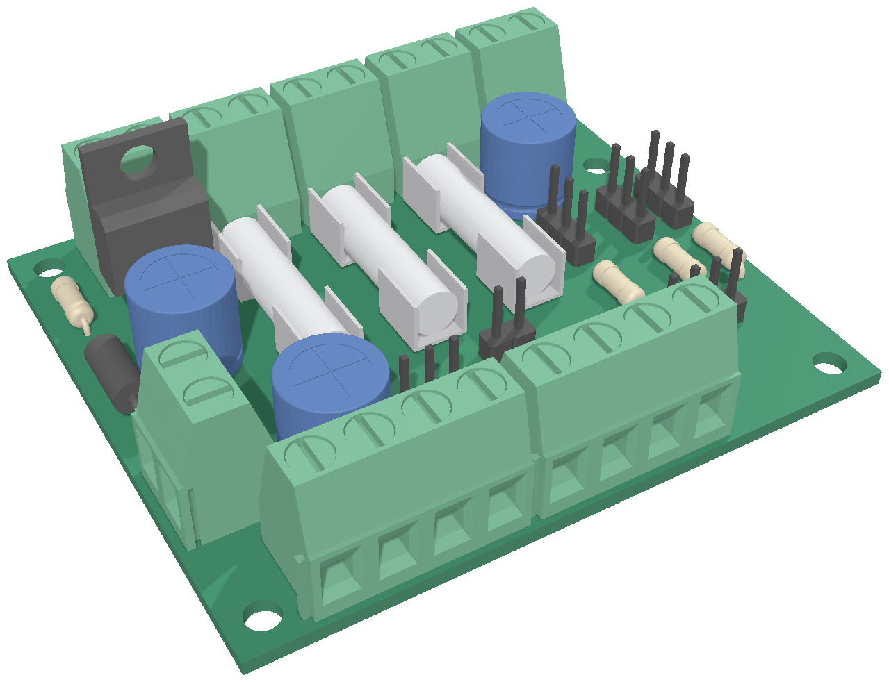

# PDE-DSM v1 — Power-distribution PCB

Power-distribution board of the vision-based 3-RRS ball-balancing mobile robot.
Single-sided board, 66.1 × 57.9 mm, milled on the UTEC L414 CNC. Designed in KiCad 9.

## Contents

| Folder / file | Description |
|---|---|
| `kicad/` | KiCad 9 project, schematic and board (`robot_v13.*`) |
| `cnc_L414/` | Fabrication files sent to the lab: bottom copper (`.gbl`), outline (`.gko`), drills (`.drl`) |
| `diagramas/` | Schematic (PDF) and external wiring (PDF and draw.io) |
| `cad3d/` | 3D model of the assembled board (STEP) |
| `imagenes/` | Component view, mirrored copper (as milled) and 3D views |
| `termico/` | Thermal analysis of the tracks (IPC-2221) and temperature maps |
| `Conexiones_y_pines.md` | Connector pinout |
| `Informe_verificacion.md` | Check against the L414 fabrication guide and IPC-2221 |
| `Anexo2_PCB_PDE-DSM_v1.pdf` | Full design document (Annex 2 of the report, in Spanish) |

## Main data

- Input: 12 V TETRIX NiMH battery through J1, reverse-polarity protection (IRF4905) and TVS (P6KE16A).
- Fused outputs: F1 6 A (XL4016 → 3 platform servos, 6 V), F2 3 A (LM2596 → leveling servo, 6 V), F3 3 A (NI myRIO).
- Auxiliary outputs: TB7 4 × 12 V, TB8 4 × GND.
- Max. 6 A continuous in total; peaks of ~10 A for a few seconds only.

License: GPL-3.0 (see the repository `LICENSE`).
