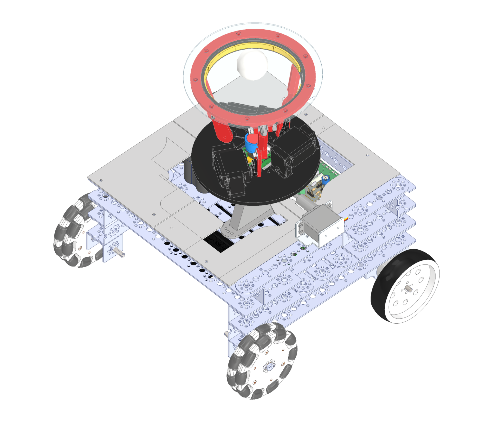
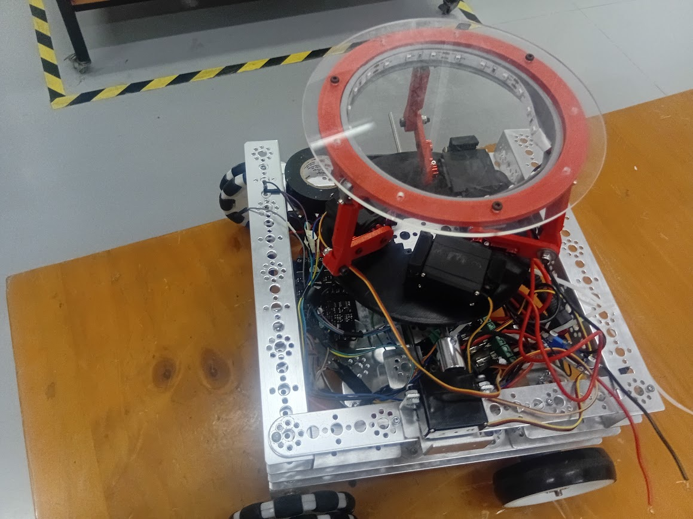
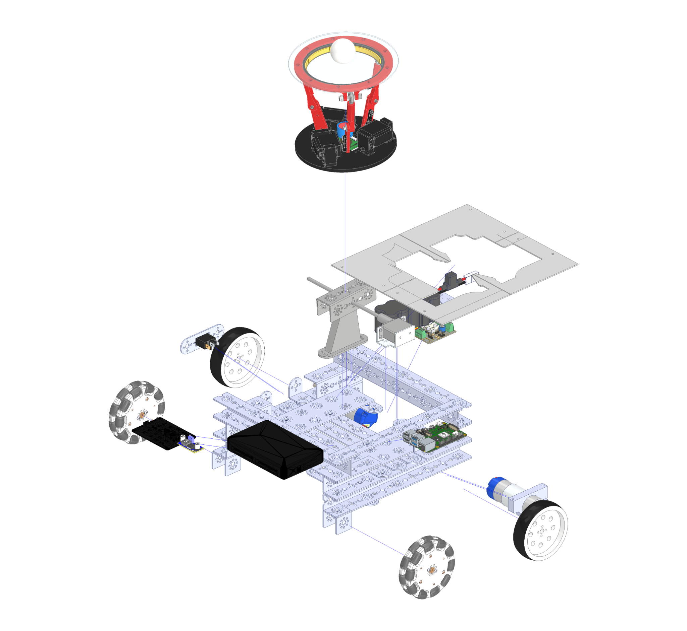
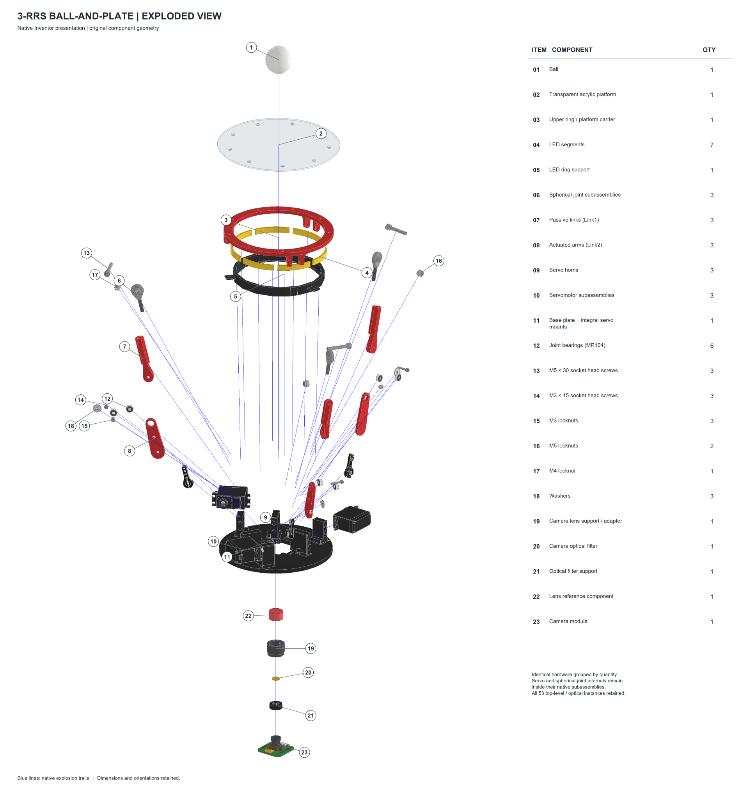
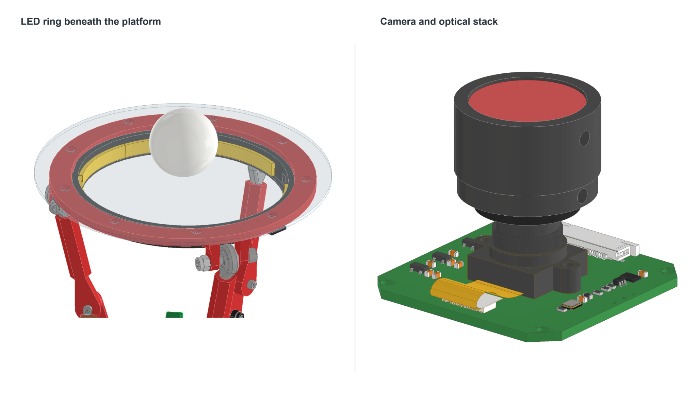
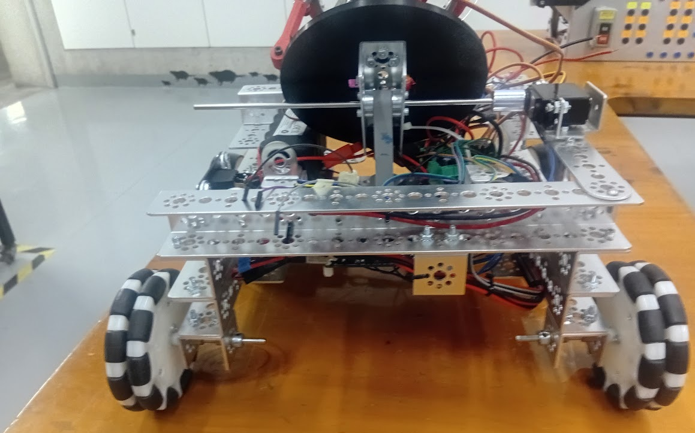
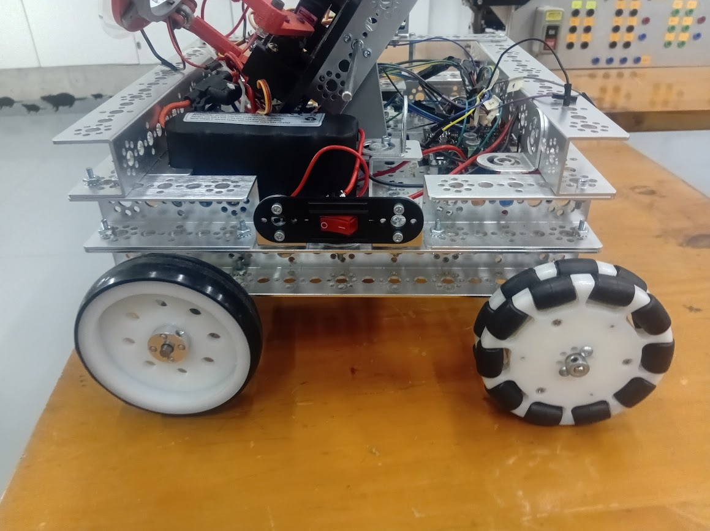
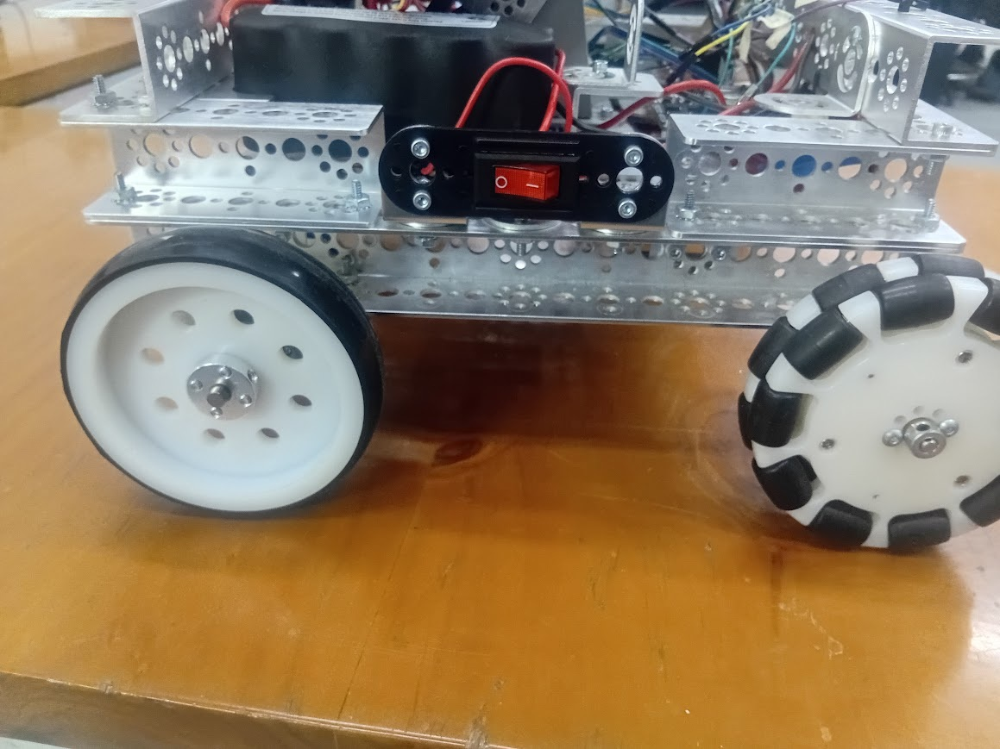
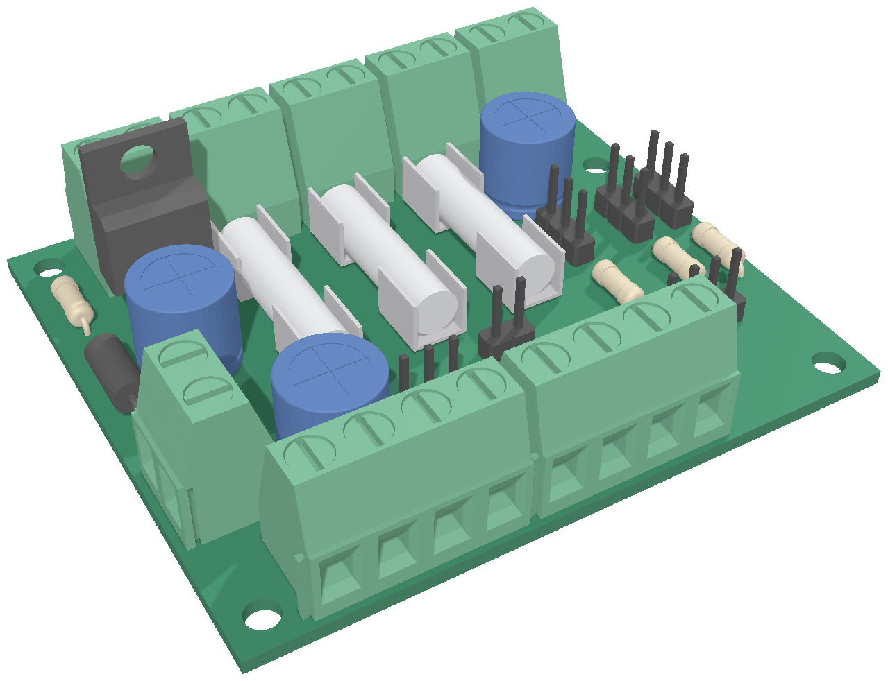

# Vision-Based Ball Balancing Using a 3-RRS Parallel Mechanism

### Mounted on a Differential-Drive Mobile Robot

  <strong>
    Universidad de Ingeniería y Tecnología (UTEC)
  </strong>
   
  Mechatronics Engineering | Diseño de Sistemas Mecatrónicos

  
  
  
  

---

## Digital and Physical Prototype

This project presents a vision-based ball-balancing
system that integrates a three-degree-of-freedom
3-RRS parallel mechanism with a differential-drive
mobile robotic platform.

<table>
<tr>
<th align="center">Digital Prototype</th>
<th align="center">Physical Prototype</th>
</tr>
<tr>
<td width="50%" align="center">

</td>
<td width="50%" align="center">

</td>
</tr>
<tr>
<td align="center">
<em>Autodesk Inventor CAD model</em>
</td>
<td align="center">
<em>Assembled laboratory prototype</em>
</td>
</tr>
</table>

<b>
Mechanical Design | Computer Vision | Parallel Robotics |
Embedded Control | Power Electronics
</b>

---

## 1. Project Overview

The project combines a mobile robotic platform
with a **3-RRS Ball-and-Plate parallel mechanism**
designed to regulate the position of a ball
through controlled platform inclination.

The system integrates:

- Differential-drive mobile locomotion.
- A three-limb 3-RRS parallel mechanism.
- Vision-based ball-position estimation.
- A transparent acrylic balancing platform.
- Circular LED illumination.
- Camera-based visual feedback.
- Distributed processing and actuation.
- A dedicated power-distribution PCB.

The mechanical structure was designed and
assembled using Autodesk Inventor and
modular TETRIX components.

### Main Processing Units

**NI myRIO-1900**

- Mobile robot drive control.
- Encoder signal acquisition.
- Inclination measurement.
- Motor control and feedback.

**Raspberry Pi 5**

- Image acquisition and processing.
- Ball-position detection.
- Camera integration.
- Ball-and-Plate actuation.

The vision system uses an Arducam OV9281
global-shutter camera positioned below
the balancing platform.

---

## 2. System Architecture

The robotic platform consists of five
main functional subsystems.

| Subsystem | Description |
|---|---|
| Mobile Robot | Differential-drive TETRIX chassis |
| 3-RRS Mechanism | Parallel balancing platform |
| Vision System | Camera and LED illumination |
| Control System | NI myRIO-1900 and Raspberry Pi 5 |
| Power Distribution | Dedicated PCB and power branches |

### Mobile Robotic Platform

The mobile robot incorporates a modular
aluminum structure, two driven wheels,
and passive omnidirectional support wheels.

The platform provides mechanical support
for the balancing mechanism and its
associated electronics.

### 3-RRS Parallel Mechanism

The balancing mechanism consists of three
servo-actuated limbs connected to a movable
platform through passive links and
spherical joints.

Its configuration allows controlled
platform inclination in roll and pitch.

### Vision System

The vision subsystem incorporates:

- Arducam OV9281 camera module.
- Camera lens and optical filter.
- Camera mounting structure.
- Circular LED illumination.
- Transparent acrylic platform.

### Distributed Control

The NI myRIO-1900 manages the mobile robot
control functions, while the Raspberry Pi 5
handles image processing and balancing
mechanism actuation.

---

## 3. Mechanical Design and CAD Assembly

The mechanical system was developed using
**Autodesk Inventor Professional 2025**.

Native Inventor files and STEP models
are provided for mechanical inspection,
design modification, and interoperability.

### 3.1 Complete Robot Assembly

<em>
Complete CAD assembly of the differential-drive
robot integrated with the 3-RRS Ball-and-Plate
mechanism.
</em>

### 3.2 Complete Robot Exploded View

<em>
Exploded view illustrating the main mechanical
and electronic subsystems of the robotic platform.
</em>

The exploded assembly highlights:

- Upper structural platform.
- Mobile robot chassis.
- Drive motor assemblies.
- Wheel assemblies.
- Electronic modules.
- 3-RRS balancing mechanism.
- Mechanical supports and interfaces.

### 3.3 3-RRS Mechanism Exploded View

<em>
Detailed exploded CAD representation of the 3-RRS
Ball-and-Plate mechanism with component
identification and bill of materials.
</em>

The mechanism includes:

- Transparent acrylic platform.
- Upper structural ring.
- LED ring and supports.
- Spherical joints.
- Passive links.
- Actuated arms.
- Three servomotors.
- Servo mounting structure.
- Camera and optical components.

---

## 4. Vision and LED Illumination System

The vision subsystem is integrated beneath
the transparent acrylic balancing platform.

The circular LED arrangement supports
illumination of the monitored area,
while the camera is mounted below
the platform for visual acquisition.

<em>
Detailed CAD visualization of the LED ring
and camera optical assembly.
</em>

### Main Optical Components

| Component | Function |
|---|---|
| Transparent Acrylic Platform | Balancing surface and optical access |
| LED Ring | Illumination of the monitored region |
| Camera Module | Image acquisition |
| Lens Assembly | Optical image formation |
| Optical Filter | Optical filtering |
| Camera Support | Mechanical positioning |

The design includes a dedicated mechanical
arrangement for the camera and its optical
components.

---

## 5. Physical Prototype

The physical prototype was assembled using
a modular TETRIX aluminum chassis.

The balancing mechanism is mounted above
the mobile base, integrating the actuation
system, transparent platform, and
vision-related components.

### Prototype Photographs

<table>
<tr>
<td align="center" width="50%">

 
<b>Isometric Overview</b>
</td>
<td align="center" width="50%">

 
<b>Front View</b>
</td>
</tr>
<tr>
<td align="center">

 
<b>Side View</b>
</td>
<td align="center">

 
<b>Power-Switch Detail</b>
</td>
</tr>
</table>

These photographs document the mechanical
integration of the mobile base, balancing
mechanism, wheel assemblies, structural
supports, and electrical wiring.

**Note:** Some CAD configurations represent
design updates and may differ from the
photographed physical prototype.

---

## 6. Power-Distribution PCB

A dedicated power-distribution printed
circuit board was developed for the
robotic platform.

The PCB was designed using **KiCad 9**
and documented for fabrication using
the laboratory CNC manufacturing process.

### PCB 3D Visualization

<em>
Three-dimensional CAD representation of
the power-distribution PCB.
</em>

### PCB Specifications

| Parameter | Specification |
|---|---|
| Design Software | KiCad 9 |
| PCB Dimensions | 66.1 x 57.9 mm |
| Board Type | Single-sided |
| Input Supply | 12 V |
| Fabrication | Laboratory CNC |
| Main Function | Power distribution and protection |

The electrical architecture includes
reverse-polarity protection, transient
protection, fused distribution branches,
and auxiliary power connections.

### PCB Design Resources

| Resource | Repository |
|---|---|
| KiCad Source Files | [View files](Power_Distribution_PCB/kicad/) |
| PCB Manufacturing Files | [View files](Power_Distribution_PCB/cnc_L414/) |
| PCB 3D CAD Model | [View files](Power_Distribution_PCB/cad3d/) |
| Electrical Diagrams | [View files](Power_Distribution_PCB/diagramas/) |
| PCB Images | [View files](Power_Distribution_PCB/imagenes/) |
| Thermal Analysis | [View files](Power_Distribution_PCB/termico/) |
| Technical Report | [View PDF](Power_Distribution_PCB/Anexo2_PCB_PDE-DSM_v1.pdf) |
| Pinout and Connections | [View document](Power_Distribution_PCB/Conexiones_y_pines.md) |
| Verification Report | [View document](Power_Distribution_PCB/Informe_verificacion.md) |

For detailed manufacturing requirements
and electrical specifications, consult
the original PCB design documentation.

---

## 7. Engineering Design Resources

The repository provides source files
and technical resources for inspecting,
reproducing, and modifying the platform.

| Design Resource | Format | Repository |
|---|---|---|
| Complete Robot Assembly | STEP | [View](Mechanical_Design/Complete_Robot/Complete_Robot_Assembly.stp) |
| 3-RRS Mechanism | STEP | [View](Mechanical_Design/Complete_Robot/3RRS_Mechanism.stp) |
| Original CAD Package | ZIP | [View](Mechanical_Design/Complete_Robot/Ensamblaje1.zip) |
| Native Inventor Assembly | IAM, IPT, IPJ | [View](Inventor_Source_Files/) |
| Mechanical Drawings | CAD, PDF | [View](Engineering_Drawings/) |
| Kinematic Analysis | MATLAB | [View](Kinematic_Analysis/) |
| CAD Visualizations | PNG | [View](CAD_Visualizations/) |
| Physical Prototype | JPG | [View](Physical_Prototype_Photos/) |
| PCB Design | KiCad, Gerber, STEP | [View](Power_Distribution_PCB/) |

---

## 8. Repository Structure

    Vision-Based-Ball-Balancing-3RRS/
    |
    |-- Mechanical_Design/
    |   `-- Complete_Robot/
    |       |-- Complete_Robot_Assembly.stp
    |       |-- 3RRS_Mechanism.stp
    |       |-- Ensamblaje1.zip
    |       `-- README.md
    |
    |-- Inventor_Source_Files/
    |   |-- DSM_CAD_REPARADO.ipj
    |   |-- Ensamblaje1.iam
    |   |-- Piezas/
    |   |-- Dependencias/
    |   `-- _Verificacion/
    |
    |-- CAD_Visualizations/
    |   |-- Full_Robot_Assembly.png
    |   |-- Full_Robot_Exploded_View.png
    |   |-- 3RRS_Mechanism_Exploded_View.png
    |   |-- Camera_and_LED_System.png
    |   `-- Additional CAD images
    |
    |-- Physical_Prototype_Photos/
    |   `-- Prototype photographs
    |
    |-- Power_Distribution_PCB/
    |   |-- kicad/
    |   |-- cnc_L414/
    |   |-- cad3d/
    |   |-- diagramas/
    |   |-- imagenes/
    |   |-- termico/
    |   `-- Technical documentation
    |
    |-- Engineering_Drawings/
    |   `-- Planos.zip
    |
    |-- Kinematic_Analysis/
    |   `-- Cinemática_RSS.m.txt
    |
    |-- README.md
    `-- LICENSE

---

## 9. Opening the Autodesk Inventor Project

**Required CAD Software:**
Autodesk Inventor Professional 2025.

### Instructions

1. Clone or download the complete repository.
2. Preserve the original directory structure.
3. Open Autodesk Inventor Professional 2025.
4. Activate the project file:

   `Inventor_Source_Files/DSM_CAD_REPARADO.ipj`

5. Open the main assembly:

   `Inventor_Source_Files/Ensamblaje1.iam`

6. Allow Inventor to resolve the referenced
   components and dependencies.
7. Verify the assembly structure and
   mechanical constraints.

The source project includes native Inventor
parts, subassemblies, and supporting
verification records.

### Verification Resources

The verification files are located in:

[Inventor Assembly Verification](Inventor_Source_Files/_Verificacion/)

These records document previous assembly
and reference checks. Users should also
verify the assembly in their local
CAD environment.

---

## 10. Kinematic Analysis

The 3-RRS parallel mechanism is supported
by a MATLAB-based inverse-kinematics model.

The analysis relates the desired platform
orientation to the actuator configuration
through the geometry of the parallel
mechanism.

**Source files:**

[Kinematic Analysis](Kinematic_Analysis/)

The currently published source uses
the `.m.txt` filename extension.

For MATLAB execution, a working copy
can be saved using the `.m` extension.

---

## 11. Design Reproduction Guidelines

For mechanical and electronic reproduction:

1. Review the available CAD models.
2. Inspect the engineering drawings.
3. Verify dimensions and component materials.
4. Check actuator operating limits.
5. Verify mechanical clearances.
6. Inspect the PCB connection diagrams.
7. Review electrical protection requirements.
8. Validate the assembly before operation.

CAD visualizations represent the
documented design configurations.

Physical prototype photographs document
the hardware arrangement shown at the
time of acquisition.

---

## 12. Original Project and Acknowledgments

The 3-RRS Ball-and-Plate mechanism was adapted
from the open-source Ball-Balancing-Robot
project developed by **I-M-Robotics-Lab**.

Original repository:

[Ball-Balancing-Robot — I-M-Robotics-Lab](https://github.com/I-M-Robotics-Lab/Ball-Balancing-Robot)

The present work integrates the mechanism
with a differential-drive mobile robot,
vision hardware, distributed control,
and a dedicated power-distribution PCB.

The original design attribution and
applicable licensing conditions are preserved.

---

## 13. License

This repository includes the
**GNU General Public License v3.0**.

See the [LICENSE](LICENSE) file
for the complete license text.

Third-party components and reused
resources remain subject to their
respective licensing and attribution
requirements.

---

## 14. Project Information

**Project Title:**

Vision-Based Ball Balancing Using a 3-RRS
Parallel Mechanism Mounted on a
Differential-Drive Mobile Robot.

**Institution:**
Universidad de Ingeniería y Tecnología (UTEC).

**Location:**
Lima, Peru.

**Course:**
Diseño de Sistemas Mecatrónicos (DSM).

**Mechanical CAD:**
Autodesk Inventor Professional 2025.

**Electronic Design:**
KiCad 9.

**Engineering Analysis:**
MATLAB.

**Computing Platforms:**
NI myRIO-1900 and Raspberry Pi 5.

**Repository Contents:**
Mechanical CAD, PCB design, engineering
drawings, kinematic analysis, CAD visualizations,
and physical prototype documentation.
