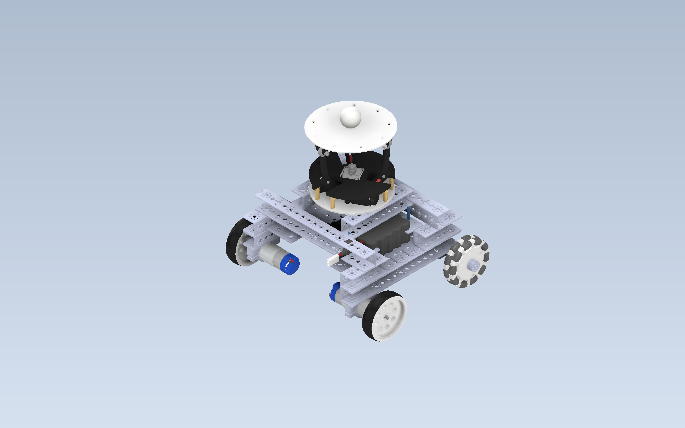
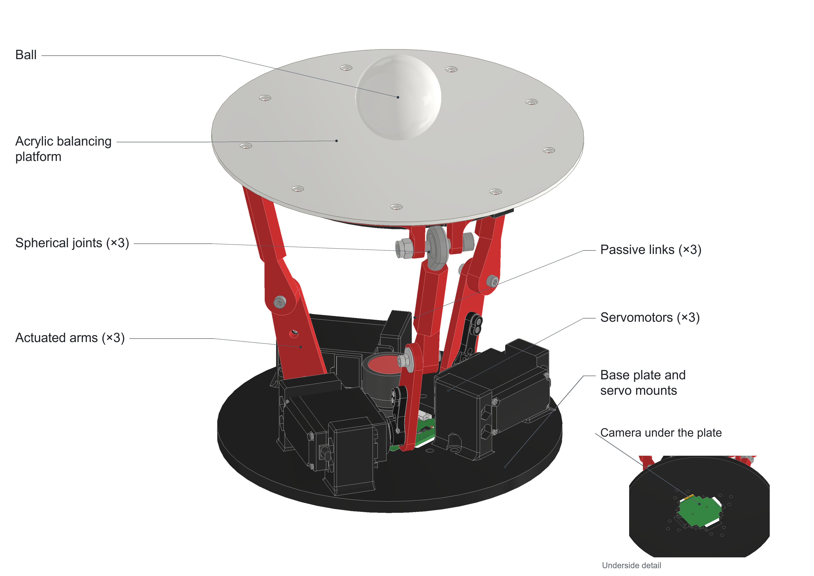
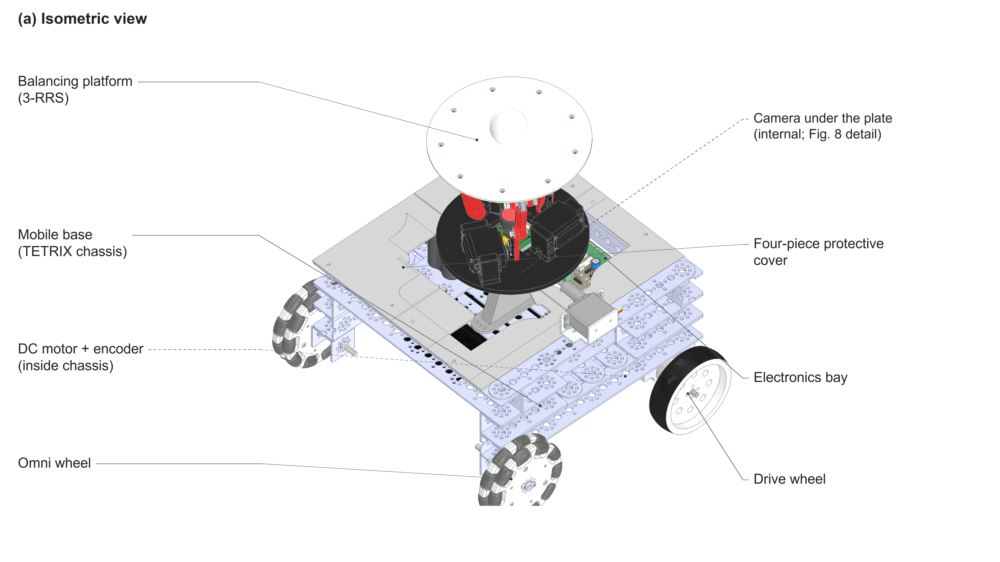

# Vision-Based Ball Balancing Using a 3-RRS Parallel Mechanism

## Mounted on a Differential-Drive Mobile Robot

<p align="center">
  
</p>

<p align="center">
  <em>CAD representation of the differential-drive mobile
  robot integrated with the 3-RRS Ball-and-Plate mechanism.</em>
</p>

---

## 1. Project Overview

This repository contains the mechanical design, CAD assemblies,
technical drawings, kinematic analysis, and supporting
documentation developed for the project:

**Vision-Based Ball Balancing Using a 3-RRS Parallel Mechanism
Mounted on a Differential-Drive Mobile Robot.**

The project integrates a differential-drive mobile robot with
a three-degree-of-freedom 3-RRS parallel mechanism designed
to regulate the position of a ball on a movable platform.

The robotic system combines locomotion, visual perception,
inclination measurement, and balancing control.

The prototype uses two main processing platforms:

- **NI myRIO-1900:** differential-drive motor control,
  encoder acquisition, and mobile-base inclination sensing.
- **Raspberry Pi 5:** image acquisition and processing using
  an Arducam OV9281 global-shutter camera, together with
  actuation of the Ball-and-Plate mechanism.

The 3-RRS mechanism adjusts the orientation of the upper
platform in roll and pitch to compensate for ball-position
errors and disturbances.

---

## 2. Main Features

- Differential-drive mobile robotic platform.
- TETRIX aluminum chassis.
- Two DC drive motors with encoder feedback.
- Passive omnidirectional support wheels.
- 3-RRS parallel Ball-and-Plate mechanism.
- Three MG996R balancing servomotors.
- Additional servomotor for inclination compensation.
- Vision-based ball-position estimation.
- Arducam OV9281 global-shutter camera.
- Raspberry Pi 5 for image processing.
- NI myRIO-1900 for mobile-base control.
- CAD assemblies developed in Autodesk Inventor 2025.
- STEP files for interoperability.
- Technical drawings and manufacturing documentation.
- Four-piece protective-cover CAD design.

---

## 3. System Architecture

The system consists of five main subsystems.

### Mobile Base

The mobile platform uses a differential-drive configuration
with two actuated wheels and passive support wheels.
The chassis is constructed using modular TETRIX
aluminum components.

### 3-RRS Balancing Mechanism

The parallel mechanism consists of three actuated limbs
connected to the movable platform through passive links
and spherical joints.

The mechanism adjusts the platform orientation to
regulate the position of the ball.

### Vision System

The Arducam OV9281 camera is positioned beneath
the balancing platform to acquire images for
ball-position estimation.

### Inclination Compensation

An additional servomotor and supporting mechanism
provide the mechanical arrangement required for
mobile-base inclination compensation.

### Distributed Control

The NI myRIO handles mobile-base locomotion and
inclination sensing, while the Raspberry Pi 5 handles
vision processing and Ball-and-Plate actuation.

---

## 4. Repository Structure

The repository is organized as follows:

```text
Vision-Based-Ball-Balancing-3RRS/
|
|-- CAD/
|   `-- Complete_Robot/
|       |-- Complete_Robot_Assembly.stp
|       |-- 3RRS_Mechanism.stp
|       |-- Ensamblaje1.zip
|       `-- README.md
|
|-- Updated_Assembly/
|   |-- Ensamblaje1.iam
|   |-- DSM_CAD_REPARADO.ipj
|   |-- Piezas/
|   |-- Dependencias/
|   |-- OldVersions/
|   `-- _Verificacion/
|
|-- Cinemática_RSS/
|   `-- Cinemática_RSS.m.txt
|
|-- Figures/
|   |-- 3-RRS.png
|   |-- A_Isometrica.png
|   |-- B_Frontal.png
|   |-- C_Lateral_izquierda.png
|   |-- D_Superior.png
|   |-- fig8_mechanism.png
|   `-- fig9a_isometric_labeled.png
|
|-- Assembly_Photos/
|   |-- assembly_01_overview.jpg
|   |-- assembly_02_front.jpg
|   |-- assembly_03_side.jpg
|   `-- assembly_04_power_switch.jpg
|
|-- Planos/
|   `-- Planos.zip
|
|-- README.md
`-- LICENSE
```

---

## 5. Original CAD Files

The original CAD files are available in:

[CAD/Complete_Robot](CAD/Complete_Robot/)

This directory contains:

| File | Description |
|---|---|
| `Complete_Robot_Assembly.stp` | STEP model of the integrated robot |
| `3RRS_Mechanism.stp` | STEP model of the balancing mechanism |
| `Ensamblaje1.zip` | Original assembly package |

The STEP files are provided for CAD interoperability.

---

## 6. Updated Autodesk Inventor Assembly

The updated assembly is located in:

[Updated_Assembly](Updated_Assembly/)

This directory contains the repaired Autodesk Inventor
project and its associated component dependencies.

The updated design includes the TETRIX mobile platform,
the 3-RRS mechanism, onboard components, and the
four-piece protective-cover CAD configuration.

### Opening the Project

**Software:** Autodesk Inventor Professional 2025.

1. Download or clone the complete repository.
2. Preserve the directory structure.
3. Open Autodesk Inventor Professional 2025.
4. Activate the project file:
   `Updated_Assembly/DSM_CAD_REPARADO.ipj`
5. Open the main assembly:
   `Updated_Assembly/Ensamblaje1.iam`
6. Allow Inventor to load the referenced components.
7. Inspect the assembly and its mechanical configuration.

The `Piezas` and `Dependencias` folders contain
the component files required by the repaired project.

### Reference Repair and Verification

The updated assembly was prepared as an independent
copy to preserve the original CAD workspace.

The verification records are located in:

[Updated_Assembly/_Verificacion](Updated_Assembly/_Verificacion/)

The recorded portable-project test reported:

- Successful opening of the extracted assembly.
- Successful closing and reopening.
- No missing references in the recorded test.
- Effective reference paths within the extracted project.
- Original source files preserved during repair.

These results document the performed verification
and do not replace checking the assembly after
downloading it into a new environment.

---

## 7. Four-Piece Protective Cover

An updated protective-cover configuration was developed
to improve coverage of the electronic components while
maintaining clearance around the balancing mechanism.

The cover consists of four independent CAD components:

1. Upper-left cover.
2. Upper-right cover.
3. Lower-left cover.
4. Lower-right cover.

The native Autodesk Inventor files are available in:

[Updated_Assembly/Piezas/Tapa_2 cuadrantes](Updated_Assembly/Piezas/Tapa_2%20cuadrantes/)

The design incorporates mounting holes and internal
cutouts adapted to the geometry of the robot.

**Important:** The four-piece protective cover is
documented as a CAD design improvement. The physical
prototype shown in the photographs does not include
these protective-cover components.

---

## 8. CAD Figures

The [Figures](Figures/) directory contains CAD views
used for the technical documentation.

### 3-RRS Mechanism

<p align="center">
  
</p>

<p align="center">
  <em>CAD representation of the 3-RRS balancing mechanism.</em>
</p>

### Integrated Robot

<p align="center">
  
</p>

<p align="center">
  <em>Updated CAD representation of the integrated robot.</em>
</p>

Additional front, side, top, and isometric views are
available in the same directory.

---

## 9. Physical Prototype Photographs

The photographs of the physical assembly are available in:

[Assembly_Photos](Assembly_Photos/)

| File | Description |
|---|---|
| `assembly_01_overview.jpg` | Isometric overview of the assembled prototype |
| `assembly_02_front.jpg` | Front view of the TETRIX chassis |
| `assembly_03_side.jpg` | Side view showing wheels and internal wiring |
| `assembly_04_power_switch.jpg` | Power switch and mechanical fastening details |

These photographs document the physical arrangement
of the chassis, balancing mechanism, wheels,
mechanical supports, and wiring.

They are provided as visual references for the
hardware construction and assembly documentation.

---

## 10. Technical Drawings

The technical drawings package is available in:

[Planos/Planos.zip](Planos/Planos.zip)

The package contains CAD drawing resources associated
with the mechanical design.

These drawings supplement the 3D CAD assemblies
and support mechanical inspection and reproduction.

---

## 11. Kinematic Analysis

The MATLAB implementation used for the analysis
of the 3-RRS mechanism is available in:

[Cinemática_RSS](Cinem%C3%A1tica_RSS/)

The script contains the geometric and mathematical
operations associated with the kinematic model.

The analysis includes the relationship between the
desired platform orientation and the corresponding
actuator configuration.

---

## 12. Design Reproduction Notes

For mechanical reproduction of the project:

1. Review the bill of materials in the technical report.
2. Download the CAD assembly and its dependencies.
3. Inspect the TETRIX chassis and the 3-RRS mechanism.
4. Consult the available technical drawings.
5. Verify the dimensions, material properties, and
   mechanical fasteners before fabrication.
6. Check the actuator travel and mechanical clearances.
7. Follow the electrical and operating precautions
   described in the project documentation.

The updated protective covers should be treated
as CAD components unless their fabrication and
physical validation are independently documented.

---

## 13. Original Project and Acknowledgment

The 3-RRS Ball-and-Plate mechanism was adapted from
the open-source Ball Balancing Robot project developed
by the I-M-Robotics-Lab.

Original project:

https://github.com/I-M-Robotics-Lab/Ball-Balancing-Robot

The present implementation integrates the mechanism
with a TETRIX differential-drive mobile platform
and the project's electronic and control architecture.

---

## 14. License

This repository includes the GNU General Public License
Version 3.0 (GPL-3.0).

See the [LICENSE](LICENSE) file for additional details.

Any reused third-party designs, software, or components
remain subject to their respective applicable licenses.

---

## 15. Project Information

**Project:** Vision-Based Ball Balancing Using a
3-RRS Parallel Mechanism Mounted on a
Differential-Drive Mobile Robot.

**Institution:** Universidad de Ingeniería y
Tecnología (UTEC), Lima, Peru.

**Course:** Diseño de Sistemas Mecatrónicos (DSM).

**CAD Software:** Autodesk Inventor Professional 2025.

**Computing Platforms:** NI myRIO-1900 and Raspberry Pi 5.

**Repository:** Mechanical design, CAD assemblies,
kinematic analysis, technical drawings, and
physical prototype documentation.
